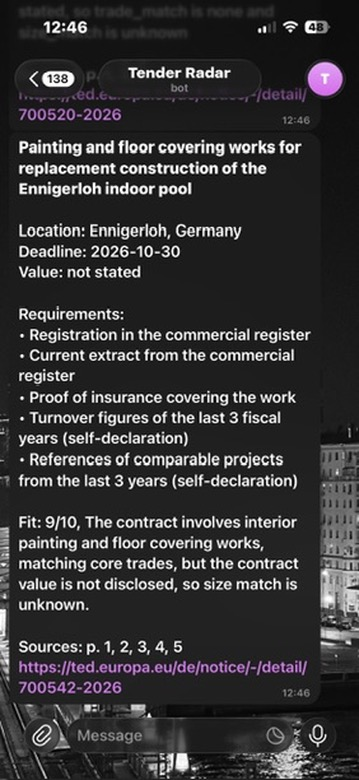
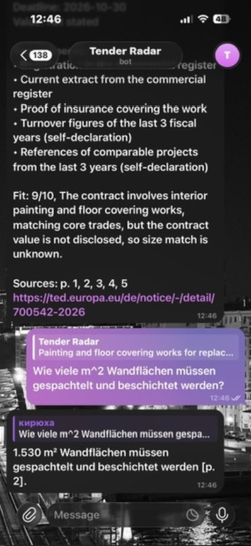
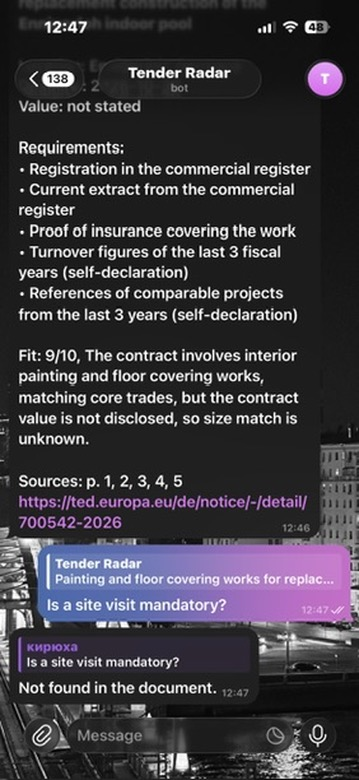
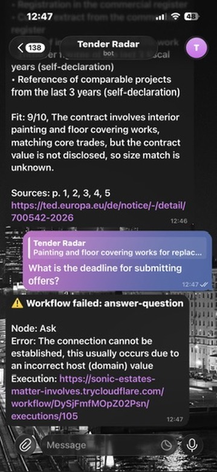
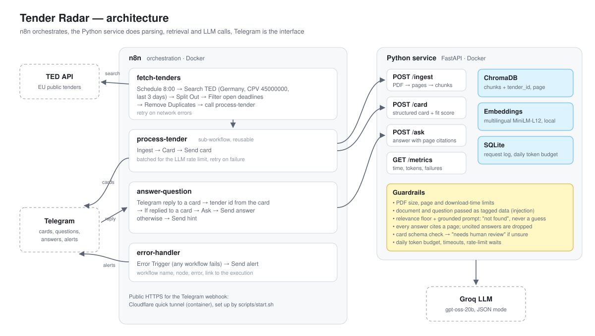

# Tender Radar

An automated pipeline that pulls fresh construction tenders from the EU TED API every
morning, reads their documents, and sends a short tender card to Telegram. Reply to a card
with a question and get an answer grounded in that tender's document, with page citations.
Orchestrated with n8n; parsing, retrieval and LLM calls live in a small FastAPI service.

Every claim the bot makes is **checked, not trusted**: answers must cite a page or are
dropped, unanswerable questions get "not found" instead of a guess, cards the model is
unsure about are flagged for human review, and retrieval quality is measured on a
labelled question set ([eval/](eval/)).

## Screenshots

<p align="center">
  
  
  
  
</p>

From left to right: **tender card** (German notice, card in English, fit score with its
reason); **cited answer** to a German question, page reference included; **honest
refusal** when the document does not contain the answer; **failure alert** from the
shared error workflow, here with the service deliberately stopped.

---

## Overview

### The problem

A construction company that wants public contracts has to watch tender portals daily,
open each notice, and read several pages of German procurement language to learn what is
built, where, by when, and what a bidder must prove. Most notices turn out to be the wrong
trade. Tender Radar does the first pass: it reads every new notice, extracts the facts
into a card, scores how well the tender fits the company, and lets a person ask follow-up
questions without opening the PDF.

### How it works



1. **Fetch** — every day at 8:00, n8n queries TED for open German construction tenders
   (CPV 45000000) published in the last 3 days, drops expired deadlines and tenders
   already processed.
2. **Ingest** — for each new tender the service downloads the notice PDF, splits it into
   page-aware chunks, embeds them with a local multilingual model and stores them in
   ChromaDB, tagged with the tender id and page.
3. **Card** — the service retrieves the chunks most relevant to each card field and asks
   the LLM for a structured JSON card. Code validates the card and computes the fit score.
4. **Notify** — n8n formats the card and sends it to Telegram.
5. **Ask** — replying to a card sends the question to the service, which searches only
   that tender's chunks and answers with page citations.
6. **Alert** — any failed workflow triggers a shared error workflow that reports the
   workflow, node and error in Telegram.

### Modular n8n workflows

| Workflow | Role |
|---|---|
| `fetch-tenders` | schedule → TED search → filter open deadlines → deduplicate → call `process-tender` |
| `process-tender` | reusable sub-workflow: ingest → card → send card |
| `answer-question` | Telegram reply → tender id from the replied card → ask → send answer |
| `error-handler` | shared error workflow for all of the above |

Exported workflows are in [workflows/](workflows/).

### Design decisions that came from testing

- **The LLM classifies, code decides.** Asking the model for a 0–10 fit score gave 9 and
  then 6 for the same tender with the same reason. Now the model only answers two
  multiple-choice questions (is this our trade: core / adjacent / none; does the size fit:
  fits / unknown / too large / too small) and code turns them into points. Three runs over
  four tenders gave identical scores, and every point can be explained.
- **Retrieval queries in the document's language.** Card queries were first written in
  English and missed the deadline in a German notice. German TED notices share one
  template, so the queries now use its exact German field labels ("Frist für den Eingang
  der Angebote"); the deadline was then found in all four test tenders.
- **The relevance floor is only a noise filter.** An on-topic question with no answer
  ("Who is the architect?") scored 0.42 similarity, higher than real answers (0.30).
  Similarity measures topical closeness, not answer presence, so the floor (0.2) only
  rejects off-topic questions; the grounded prompt handles the rest.

### Guardrails

| Risk | Guardrail |
|---|---|
| Guessing when the document is silent | relevance floor + grounded prompt return "not found" |
| Uncited claims | an answer without a valid excerpt reference is dropped; page references are added in code |
| Prompt injection from tender text | document and question reach the model only inside `<document>` / `<question>` tags, declared untrusted |
| Malformed or unsure cards | JSON schema check; missing deadline, low confidence, invalid sources → "needs human review" |
| Huge or broken PDFs | size (10 MB), page (50) and download-time (30 s) limits; non-PDF content rejected |
| Burning the free tier | daily token budget (150k) checked before every LLM call |
| Transient failures | per-minute rate limits waited out, retries on network errors, alert on final failure |

---

## Results

### Q&A quality

Evaluation set: 15 hand-written questions over 4 real tenders, in English, German and
Russian: 12 answerable (expected page labelled) and 3 whose answer is not in the
document. Run: [eval/run_eval.py](eval/run_eval.py), results: [eval/results.json](eval/results.json).

| Metric | Result |
|---|---|
| Retrieval hit@1 (answer page ranked first) | 10/12 |
| Retrieval hit@3 | 11/12 |
| **Correct answers** | **11/12** |
| **Correct refusals** (answer not in the document) | **3/3** |

A first run gave 7/12 correct answers. Two settings were tuned on this same set (top-k
5 → 8, relevance floor 0.3 → 0.2), so the 11/12 is optimistic; see Error Analysis.

### Operations

Measured from the service's request log (`GET /metrics`, SQLite) over one day of use:
49 requests: 15 ingests, 24 cards, 10 questions.

| Metric | Median |
|---|---|
| Ingest (download + parse + embed) | 1.7 s |
| Card generation | 2.3 s, ~3,300 tokens |
| Question answer | 0.9 s, ~1,600 tokens |
| **Per tender, processing** (ingest + card) | **~4 s, ~3,300 tokens** |
| Failed requests | 2 of 49: one deliberate test, one rate-limit failure before rate-limit waiting was added |

**Time saved (assumption, not measured):** reading a 5–7 page German notice to extract
scope, deadline and requirements and to judge fit takes an estimated 10–15 minutes. The
card takes about 30 seconds to read. At 10 relevant tenders a day that is roughly 1.5–2
hours of reading replaced by 5 minutes.

---

## Error Analysis

- **German terms vs English questions.** "Which review body handles complaints?" was
  answered with "the contracting authority" instead of the Vergabekammer Westfalen. The
  right chunk ("Überprüfungsstelle: …") ranked 15th: the multilingual embedding model
  matches formal German procurement terms poorly to English wording. "When do the works
  start?" had the same problem ("Datum des Beginns" ranked 8th) and is only solved by the
  wider top-k. Candidates: hybrid keyword + vector search, or translating the question
  into German before retrieval.
- **Tuned on the test set.** Top-k and the relevance floor were adjusted after looking at
  failures of these 15 questions. A fresh question set would give a fairer number.
- **Small evaluation.** 12 answerable questions, so one question is 8 percentage points;
  results are directional.
- **Only the notice, not the full tender documents.** TED hosts the notice (typically 5–7
  pages). The full documentation sits on procurement portals that often require
  registration, so cards and answers cover what the notice states.
- **Contract value is rarely published.** Only 15 of 100 recent German construction
  notices state an estimated value, so the size part of the fit score is usually
  "unknown".
- **Five tenders per run.** The TED query takes the first 5 matching notices per run, a
  cap set for the free LLM tier while testing. One card costs ~3,300 tokens, so the daily
  budget would allow about 45; raise `limit` in the `Search TED` node.
- **A failed tender is not retried automatically.** Deduplication records a tender
  before it is processed; if processing fails, the alert names it, but it will not be
  picked up again on the next run.
- **The model sometimes copies German.** Requirements were occasionally left in German
  despite the instruction; repeating the instruction after the document fixed it in
  testing, but it is a prompt, not a guarantee.

---

## Tech Stack

| Layer | Tools |
|---|---|
| Orchestration | n8n (schedule, HTTP, sub-workflows, error workflow, Telegram) |
| Service | Python, FastAPI, Pydantic |
| Parsing | PyMuPDF (text per page, page numbers for citations) |
| Embeddings | sentence-transformers, `paraphrase-multilingual-MiniLM-L12-v2` (local, CPU) |
| Vector store | ChromaDB |
| LLM | Groq API, `openai/gpt-oss-20b`, JSON mode, behind one swappable module |
| Metrics | SQLite request log, `GET /metrics` |
| Interface | Telegram bot |
| Infrastructure | Docker Compose, Cloudflare quick tunnel for the Telegram webhook |
| Tests | pytest (32 tests, no network or LLM needed) |

---

## Project Structure

```
├── service/
│   ├── app/
│   │   ├── main.py        # FastAPI: /ingest, /card, /ask, /metrics, /health
│   │   ├── ingest.py      # download PDF (limits) -> parse pages -> chunk -> embed -> ChromaDB
│   │   ├── card.py        # field queries -> LLM card -> schema check, review flags, fit score
│   │   ├── ask.py         # tender-scoped retrieval -> grounded answer with page citations
│   │   ├── llm.py         # the only file that talks to the LLM provider: retries, budget
│   │   ├── metrics.py     # SQLite request log, daily token count, /metrics summary
│   │   └── config.py      # every tunable: limits, model, chunking, fit-score profile
│   ├── tests/             # parsing, chunking, PDF limits, guardrails, API validation
│   └── Dockerfile
├── workflows/             # exported n8n workflows (chat id replaced by a placeholder)
├── eval/
│   ├── questions.json     # labelled questions: expected page and accepted answers
│   ├── run_eval.py        # hit@1, hit@3, answer correctness, refusals
│   └── results.json       # last run
├── scripts/
│   ├── start.sh           # start everything, wire the tunnel address into n8n
│   └── export_workflows.py
├── docs/architecture.svg
├── screenshots/
├── docker-compose.yml     # n8n + service + tunnel
└── .env.example
```

---

## Getting Started

### Prerequisites

- Docker Desktop
- A Telegram bot token from [@BotFather](https://t.me/BotFather) and your chat id
  (send any message to [@userinfobot](https://t.me/userinfobot))
- A free Groq API key from [console.groq.com](https://console.groq.com)

### Run

```bash
git clone https://github.com/Kirill-ark/tender-radar.git
cd tender-radar
cp .env.example .env          # put your Groq key into .env
./scripts/start.sh
```

`start.sh` builds the service, opens a Cloudflare tunnel (a public HTTPS address that
Telegram needs to deliver messages) and starts n8n with that address. The first build
downloads the embedding model and takes a few minutes.

### Set up n8n

1. Open http://localhost:5678 and create the local owner account.
2. Create a **Telegram** credential with your bot token.
3. Import the four files from `workflows/` (Workflows → Import from File), select your
   Telegram credential in each Telegram node, and replace `YOUR_TELEGRAM_CHAT_ID` with
   your chat id.
4. In `fetch-tenders`, `process-tender` and `answer-question` set Settings → Error
   Workflow to `error-handler`, and point the `Call 'process-tender'` node to your
   imported `process-tender`.
5. Publish all four workflows.

The quick tunnel gets a new address on every start, and n8n registers the Telegram webhook
only when a workflow is published. After a restart, unpublish and publish
`answer-question` once so that replies reach the bot again.

### Tests and evaluation

```bash
docker compose exec service python -m pytest -q
docker compose exec service python -m eval.run_eval
```

The evaluation needs the four tenders from `eval/questions.json` to be ingested
(run `fetch-tenders` while they are open, or call `/ingest` for them).

---

## API

`POST /ingest` — download and index one tender notice.

```json
{"tender_id": "674261-2026", "pdf_url": "https://ted.europa.eu/de/notice/674261-2026/pdf"}
→ {"tender_id": "674261-2026", "chunks": 50}
```

`POST /card` — structured card for an ingested tender.

```json
{"tender_id": "674261-2026"}
→ {"card": {"what": "...", "location": "...", "deadline": "2026-11-02", "requirements": [...],
            "trade_match": "core", "size_match": "unknown", "fit_score": 9, "fit_reason": "..."},
   "citations": [{"file": "674261-2026.pdf", "page": 1}, ...],
   "needs_review": false, "review_reasons": [], "usage": {...}}
```

`POST /ask` — answer a question from one tender's document.

```json
{"tender_id": "674261-2026", "question": "How many references are required?"}
→ {"found": true, "answer": "Three references are required [p. 4].",
   "citations": [{"file": "674261-2026.pdf", "page": 4}], ...}
```

`GET /metrics` — request counts, failure rate, durations and tokens per endpoint, tokens
spent today. `GET /health` — liveness check.
